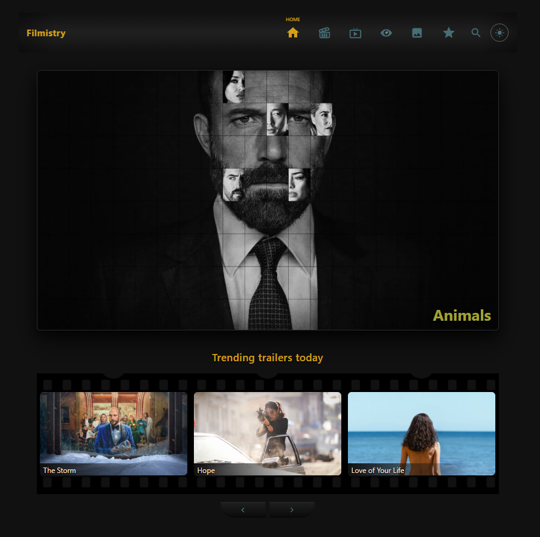
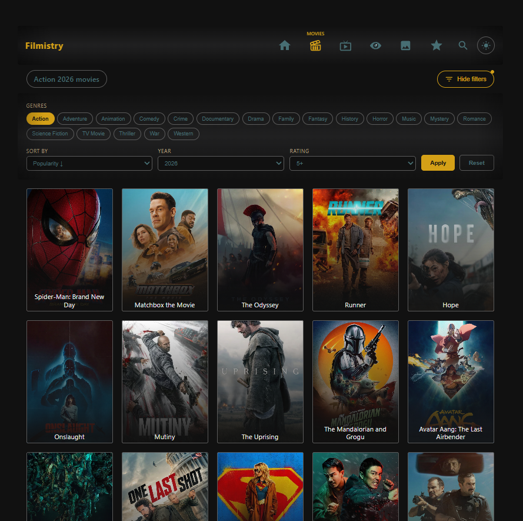
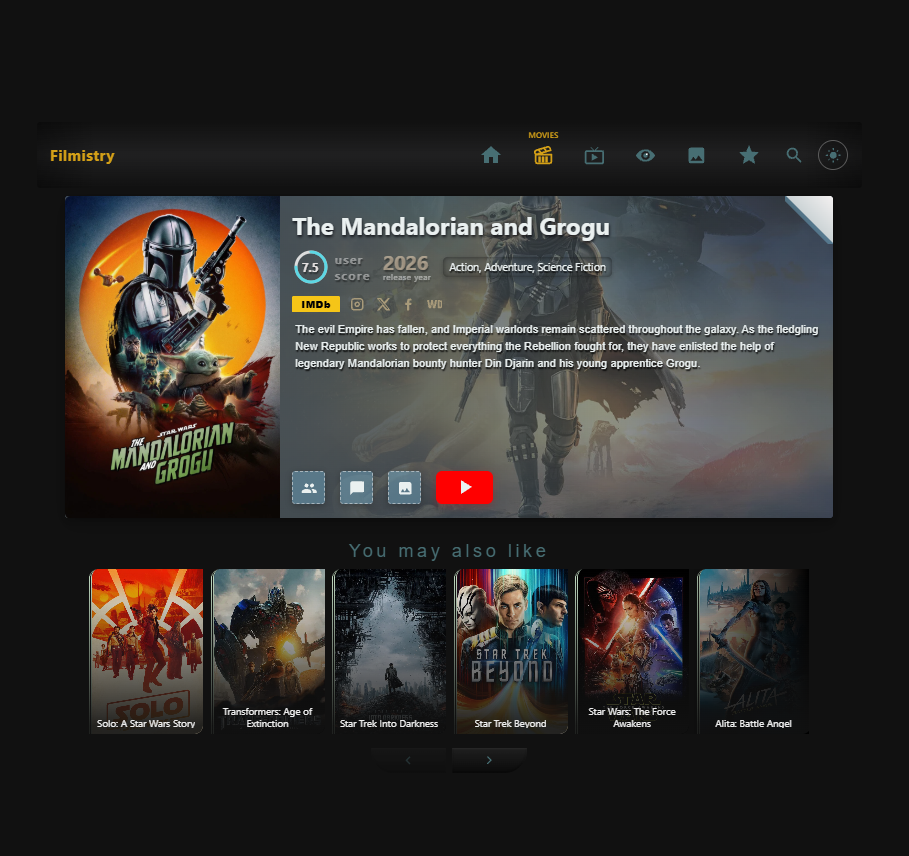
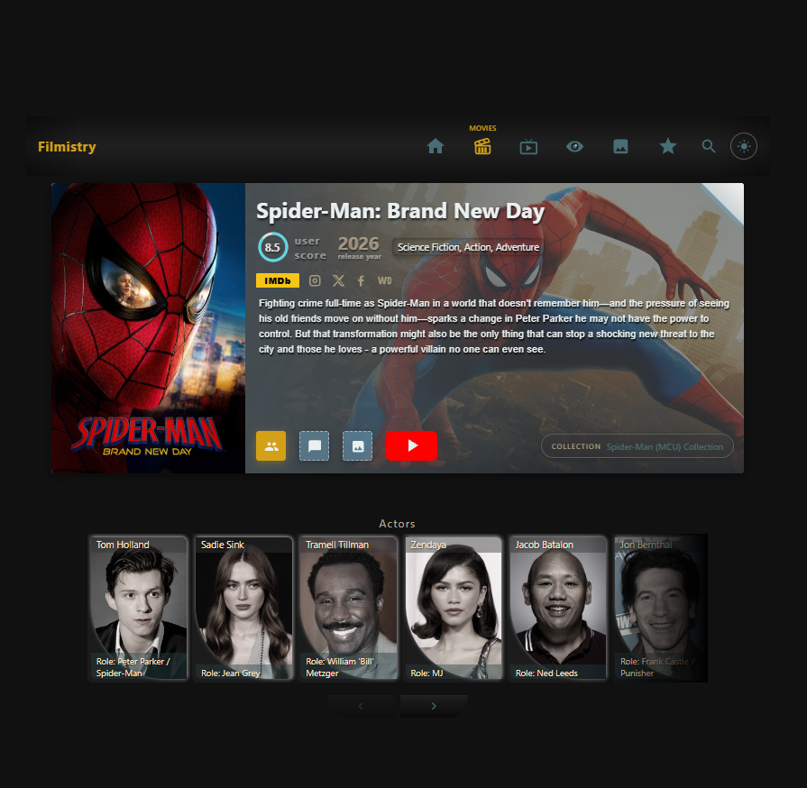
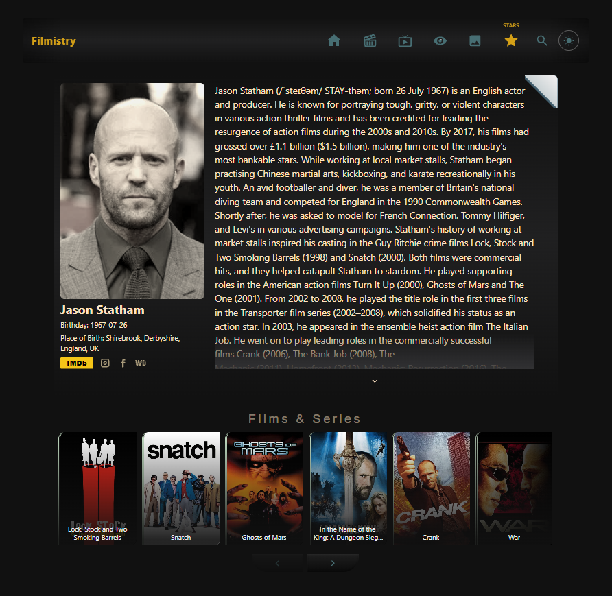
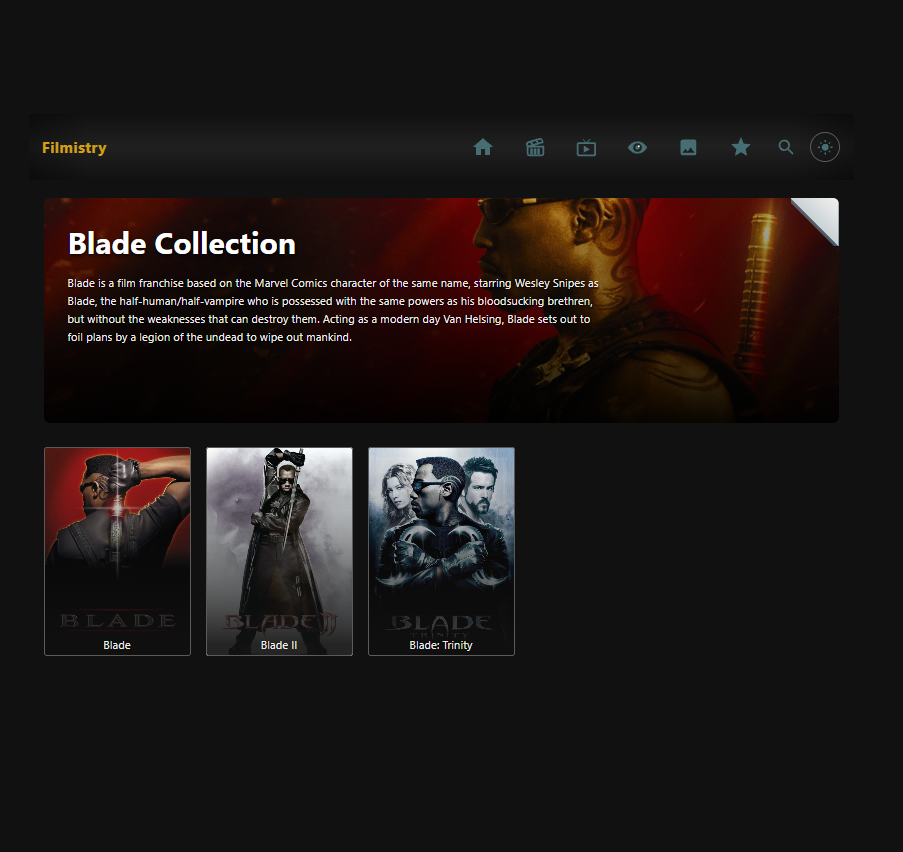
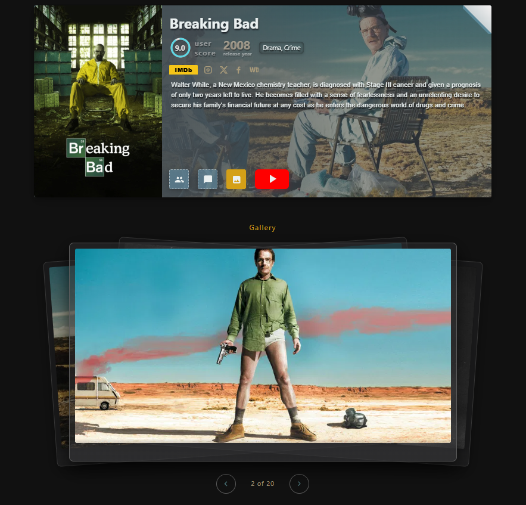
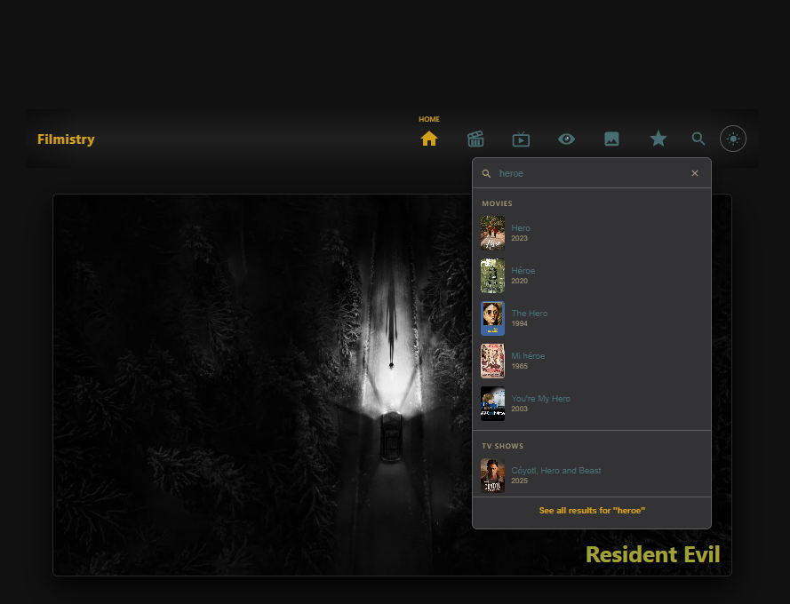
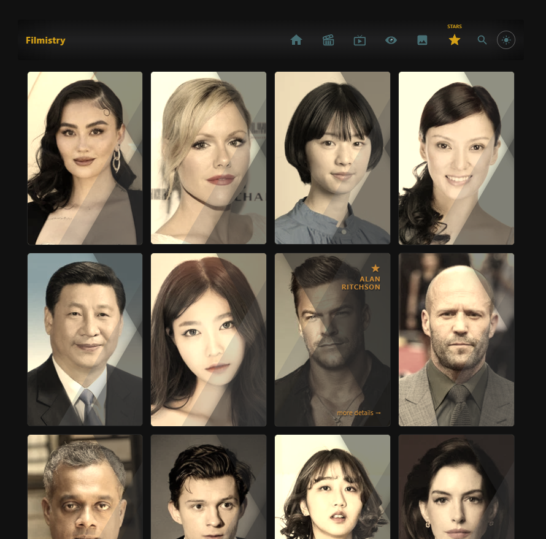
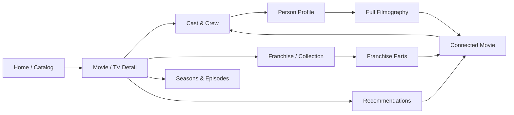

# 🎬 Filmistry

<p align="center">
  
</p>

<p align="center">
  <strong>A modern, high-performance cinematic discovery platform featuring recursive graph traversal and fullstack SSR architecture</strong>
</p>

<p align="center">
  <a href="#-features">Features</a> •
  <a href="#-architecture--graph-traversal">Architecture</a> •
  <a href="#-tech-stack">Tech Stack</a> •
  <a href="#-interface-showcase-screenshots">Screenshots</a> •
  <a href="#-getting-started">Getting Started</a> •
  <a href="#-project-structure">Structure</a>
</p>

<p align="center">
  
  
  
  
  
  
</p>

---

## 📌 About Filmistry

**Filmistry** is a fullstack entertainment web application designed for cinephiles, built using **Angular SSR (Server-Side Rendering)** and the **BFF (Backend-For-Frontend)** architecture pattern powered by **Express 5**.

Rather than offering a conventional movie catalog, Filmistry constructs an interconnected **cinematic knowledge graph**: users can navigate continuously through film universes — jumping from movie details to an actor's profile, from that actor to their full filmography, from another movie to franchise collections or specific TV seasons, and onward through recommendations — all with zero layout lag, preserved scroll positions, and instant response times.

---

## 📸 Interface Showcase (Screenshots)

### 1. Home Page (Hero, Trailers & Randomizer)
Interactive media randomizer for serendipitous film discovery, paired with an auto-sliding billboard carousel and embedded YouTube trailer modal:

<p align="center">
  
</p>

---

### 2. Media Catalog & Multi-Parameter Filtering
Rich media catalog with an expandable filter panel: genre combinations, release year sliders, rating thresholds, and multiple sorting criteria:

<p align="center">
  
</p>

---

### 3. Media Detail View
Immersive backdrop presentation, SVG arc rating indicator, external social links (IMDb, TMDB, socials), synopsis, and section switchers:

<p align="center">
  
</p>

---

### 4. Cast & Crew Carousel
Smooth, touch-enabled horizontal carousel displaying cast members, roles, and profile avatars linking directly to person details:

<p align="center">
  
</p>

---

### 5. Person Profile (Actor / Director)
Biographical details with dynamic column balancing via `ResizeObserver`, "Known For" highlights, and complete credits carousel:

<p align="center">
  
</p>

---

### 6. Movie Franchises & TV Seasons
Sequel and prequel clustering for major cinematic universes (e.g., Marvel, Harry Potter) alongside season-by-season episode breakdowns:

<p align="center">
  
</p>

---

### 7. Media Gallery & Fullscreen Lightbox
High-resolution backdrop showcase with custom fullscreen lightbox modal, keyboard navigation, and backdrop slider:

<p align="center">
  
</p>

---

### 8. Multi-Entity Live Search
Header-level search bar featuring debounce-controlled querying, grouped instant previews (Movies, TV Series, People), and dedicated `/search` page:

<p align="center">
  
</p>

---

### 9. Stars & Celebrities Directory (`/people`)
Dedicated catalog of cinema personalities, popular actors, and directors featuring responsive grid cards, pagination, and direct transitions to personal profiles and filmographies:

<p align="center">
  
</p>

---

## 🧠 Architecture: Recursive Graph Traversal & Multi-Tier Caching

A defining architectural pillar of Filmistry is the **frictionless recursive graph navigation** ("Infinite Traversal").



### 1. Seamless Deep Graph Navigation
- Starting from `/movies/:id`, the user can navigate endlessly:
  - Open the cast section $\rightarrow$ click an actor $\rightarrow$ visit `/people/:personId`.
  - Explore the actor's biography $\rightarrow$ browse their filmography carousel $\rightarrow$ select another movie $\rightarrow$ navigate to `/movies/:otherId` or `/tv/:otherId`.
  - On the new title, select its franchise $\rightarrow$ arrive at `/collection/:collectionId`, displaying all related installments.
  - Every franchise item links to its own detail view, complete with new cast members and recommendations.
  - Explore TV seasons at `/tv/:id/season/:seasonNumber` with per-episode stills and overviews.

### 2. 3-Tier State Preservation & Caching
To ensure deep branching traversals feel instantaneous without hitting TMDB rate limits, a multi-tier cache is implemented:

1. **Component State Level (`NavigationStateService`)**:
   - In-memory **LRU Cache** (up to 20 views) with a **TTL of 5 minutes**.
   - When navigating away from a movie or actor, their resolved state, external IDs, and view parameters are cached in memory.
   - Navigating backwards (`location.back()`) restores the entire page state immediately — no re-fetching, spinners, or lost context.
2. **Client HTTP Interceptor Level (`cacheInterceptor`)**:
   - Angular HttpInterceptor intercepts all GET requests targeting `/api/*`.
   - Caches up to 100 endpoint responses for 5 minutes, preventing redundant roundtrips across tab switching (Cast, Reviews, Gallery).
3. **Server-Side BFF Level (`tmdb-client.ts`)**:
   - In-memory cache on the Node.js Express server (up to 500 requests, 60s TTL).
   - Protects the private TMDB API key and absorbs traffic spikes from concurrent users.

### 3. BFF (Backend-For-Frontend) & Security
- The client browser **never calls the TMDB API directly**; `TMDB_ACCESS_TOKEN` is strictly confined to server-side memory.
- All requests target local endpoints: `/api/movies`, `/api/tv`, `/api/trending`, `/api/people`, `/api/search`, `/api/genres`, `/api/discover`, `/api/collections`.
- Express routes normalize and clean raw API responses using server-side mappers (`src/server/mappers`), stripping unused payload fields and minimizing client bandwidth.

---

## ⚡ UI/UX Engineering Highlights

- **Angular Signals**: Full reactivity powered by Signals (`signal`, `computed`, `effect`, `input.required`, `output`, `viewChild`). Ensures granular DOM updates without unnecessary zone cycles.
- **Interactive Page Curl Effect**: SVG/CSS corner-peel visual animation on detail headers for closing or retreating up the graph hierarchy.
- **Dynamic Rating Bar**: SVG arc score visualizer dynamically calculating circumference stroke offsets and color gradients based on vote averages.
- **Dynamic Offset Filter Panel**: Recalculates title and toggle button alignments dynamically (`ResizeObserver` + `requestAnimationFrame`) and synchronizes active filters with query params.
- **Dual Theming System (`Dark` & `Sepia`)**: Built-in instant theme switcher toggling between modern sleek dark mode and atmospheric warm cinema sepia mode using dynamic CSS custom properties, with selection persisted in `localStorage`.
- **Hybrid Responsive & Adaptive Architecture**: Carefully engineered layout tailored for everything from mobile phones to high-resolution desktop monitors. Includes fluid CSS grids, touch-friendly swipeable carousels, an accessible slide-out mobile drawer menu (`app-mobile-menu`), and dynamic column height calculations via `ResizeObserver`.
- **Custom Lightbox**: Lightweight modal service featuring slide counters, full keyboard support (`ArrowLeft`, `ArrowRight`, `Escape`), and body scroll locking.
- **Reduced Motion Support**: Inspects `prefers-reduced-motion` to skip exit animations and execute instant route transitions for accessibility.

---

## 🛠 Tech Stack

| Category | Technology |
| :--- | :--- |
| **Frontend Framework** | [Angular](https://angular.dev/) 22.x (Signals, Standalone Components, Modern `@if/@for` Control Flow) |
| **SSR / Rendering** | [@angular/ssr](https://www.npmjs.com/package/@angular/ssr), `AngularNodeAppEngine`, Node.js |
| **Backend / BFF** | [Express](https://expressjs.com/) 5.x, Node.js HTTP Pipeline, `dotenv` |
| **Language** | [TypeScript](https://www.typescriptlang.org/) 6.x (Strict type checking) |
| **Styling** | SCSS, CSS Custom Properties (Theming: Dark / Sepia), CSS Grid, Flexbox |
| **UI Primitives** | [@angular/cdk](https://material.angular.io/cdk/categories) (A11y & Overlay utilities) |
| **Reactive Streams** | [RxJS](https://rxjs.dev/) 7.8 (debounceTime, distinctUntilChanged, switchMap) |
| **External API** | [The Movie Database (TMDB) API v3](https://developer.themoviedb.org/docs) |
| **Unit Testing** | [Vitest](https://vitest.dev/), jsdom |
| **Deployment** | [Vercel](https://vercel.com/) (Serverless Function entry via `api/index.js`) |

---

## 📂 Project Structure

```text
filmistry/
├── api/                        # Vercel Serverless Function entry point
│   └── index.js                # Bridges incoming requests to the compiled SSR engine
├── public/                     # Static assets
│   ├── img/                    # Fallback graphics, posters, branding assets
│   └── screens/                # Screenshots for documentation
├── src/
│   ├── app/
│   │   ├── core/               # Core singleton services, models, and interceptors
│   │   │   ├── constants/      # Genre mappings, country lists
│   │   │   ├── interceptors/   # cacheInterceptor (HTTP GET cache)
│   │   │   ├── models/         # TypeScript models (Media, Person, Collection, etc.)
│   │   │   └── services/       # MediaService, PeopleService, NavigationStateService, ThemeService
│   │   ├── features/           # Feature pages and route components
│   │   │   ├── home/           # Landing page, media randomizer, trailer bar
│   │   │   ├── media/          # Movies, TV shows, anime, cartoons, seasons, collections
│   │   │   │   └── pages/media-detail-page/sections/ # Cast, Gallery, Reviews, Recommendations
│   │   │   ├── people/         # Stars directory and detailed person profile
│   │   │   └── search/         # Dedicated multi-entity search view with tabs
│   │   ├── shared/             # Reusable UI components
│   │   │   ├── carousel/       # Smooth touch carousel
│   │   │   ├── external-links/ # Social & database links (IMDb, TMDB, socials)
│   │   │   ├── filters-panel/  # Collapsible filtering and sorting toolbar
│   │   │   ├── header/         # Global header with mega-menus, search, and theme toggle
│   │   │   ├── icon/           # SVG icon component
│   │   │   ├── loader/         # Cinema-themed loading indicator
│   │   │   ├── page-curl/      # Paper page-peel corner transition
│   │   │   ├── pagination/     # Numeric pagination controls
│   │   │   └── search-bar/     # Autocomplete search input
│   │   ├── app.config.ts       # Client application configuration
│   │   ├── app.config.server.ts# Server-side Angular configuration
│   │   └── app.routes.ts       # Root router configuration with lazy loading
│   ├── server/                 # Express-based BFF server implementation
│   │   ├── dto/                # TMDB API Data Transfer Objects
│   │   ├── mappers/            # TMDB -> Application Model transforms
│   │   ├── routes/             # API routes: /movies, /tv, /people, /search, /discover
│   │   ├── tmdb-client.ts      # TMDB HTTP Client with server-side LRU cache
│   │   └── server.ts           # Express SSR & API Server initialization
│   ├── styles/                 # Global SCSS stylesheets & theme definitions
│   └── main.ts                 # Browser client bootstrap entry point
├── vercel.json                 # Vercel deployment configuration
├── angular.json                # Angular CLI workspace configuration
└── package.json                # Project dependencies and npm scripts
```

---

## 🚀 Getting Started

### Prerequisites
- **Node.js**: `18.x` or `20.x` (LTS recommended)
- **npm**: `9.x` or later
- **TMDB API Read Access Token**: obtain a free API Read Access Token v4 from [The Movie Database](https://www.themoviedb.org/settings/api).

### 1. Clone the Repository
```bash
git clone https://github.com/your-username/filmistry.git
cd filmistry
```

### 2. Install Dependencies
```bash
npm install
```

### 3. Environment Configuration
Create a `.env` file in the root directory (based on `.env.example`):
```env
TMDB_ACCESS_TOKEN=your_tmdb_read_access_token_v4_here
PORT=4000
```

### 4. Run Development Server
```bash
npm start
```
Open your browser and navigate to [http://localhost:4200](http://localhost:4200).

### 5. Production Build & SSR Execution
```bash
# Build client and server bundles
npm run build

# Start the Node.js Express SSR server
npm run serve:ssr:filmistry
```
The application will serve from port `4000`: [http://localhost:4000](http://localhost:4000).

### 6. Run Unit Tests
```bash
npm test
```

---

## ☁️ Deployment (Vercel)

Filmistry is configured out of the box for deployment on **Vercel Serverless Functions**:
1. `vercel.json` routes all client requests to `api/index.js`.
2. The serverless function delegates to `dist/filmistry/server/server.mjs`.
3. In Vercel Project Settings $\rightarrow$ Environment Variables, configure:
   - `TMDB_ACCESS_TOKEN` = `<your_token>`
4. Build Command: `npm run build`, Output Directory: `dist/filmistry/browser`.

---

## 📄 License & Attribution

This project is created for educational and portfolio demonstration purposes. All movie, television, actor metadata, and media imagery are provided courtesy of [The Movie Database (TMDB)](https://www.themoviedb.org/).
